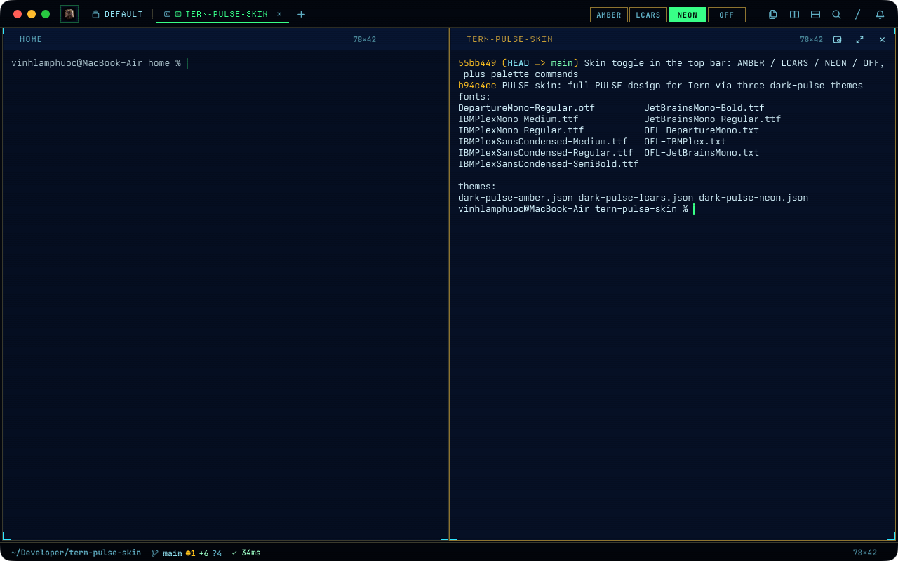
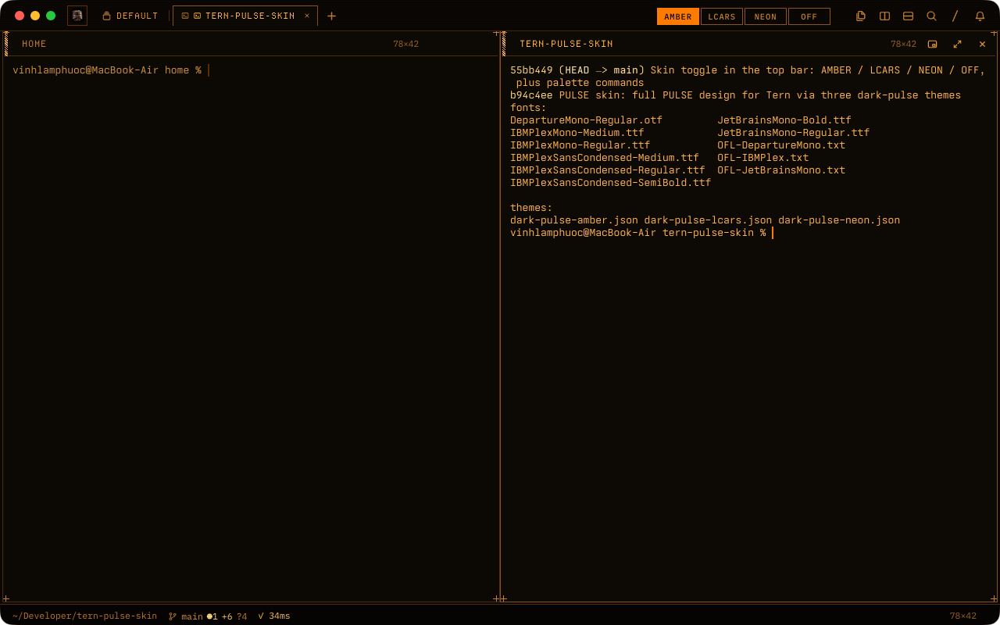
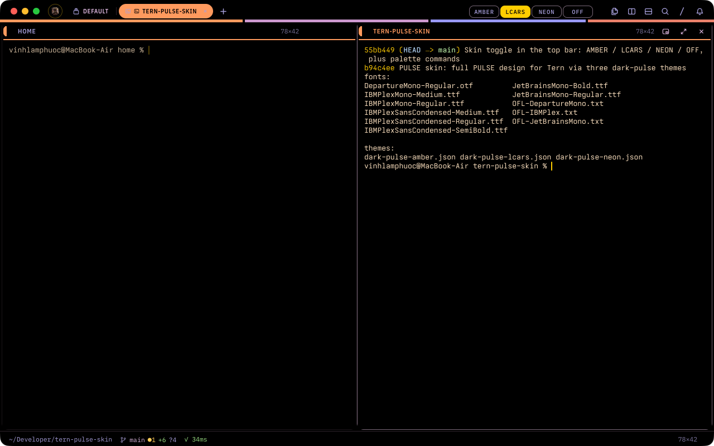

# PULSE skin for Tern



Three full skins for [Tern](https://docs.stencil.so/tern/): **Amber Phosphor**, **LCARS Deck** and **Neon Command**. Each one restyles the whole window, not just its colours: fonts, square or pill shapes, tab style, labelled panel headers, scanlines, corner marks, and the LCARS colour band and header caps.

The skin restyles Tern's shared tokens and surface kit, not any one plugin. Every plugin that draws with Tern's canvas and blocks (Roost, Overseer, Agent Scheduler, …) follows it.

| Amber Phosphor | LCARS Deck |
|---|---|
|  |  |

## Install

```sh
tern plugin install github.com/roverdude24/tern-pulse-skin
```

On its first start the plugin copies its three themes into omp's themes folder (`~/.omp/agent/themes`, or Tern's `omp_dir`) and its fonts into `~/Library/Fonts`. When it adds fonts it says so: run `tern restart` once so Tern picks them up.

## Use

- **Top bar toggle:** click **AMBER**, **LCARS**, **NEON** or **OFF**, just left of Tern's tool buttons. The lit one is the current skin.
- **Palette:** ⌘K, then `PULSE skin: Amber`, `LCARS`, `Neon` or `Off`.
- **Theme picker:** choosing `dark-pulse-amber`, `dark-pulse-lcars` or `dark-pulse-neon` turns the matching skin on. Any other theme turns it off within 1.5 s.

OFF goes back to the last non-PULSE dark theme you used. Keep Tern's Appearance on **Dark**: the skin follows the dark theme.

## Limits

- Tern gives plugins no top-bar slot. The toggle is a status-line item drawn in the top bar, at fixed offsets that suit the Tiles and Float layouts. In the Rail layout it can sit in the wrong place, and with the status bar turned off it is hidden (the palette commands still work).
- Tern's renderer has no `text-shadow`, so the design's text glow is left out.
- Colours a plugin hard-codes, such as Roost's folder badges, stay as they are.

## Develop

`tern plugin link .` reloads on every save. The skins live in `skins.luau`. Their `--pk-*` tokens come from the PULSE app design's `tokens.json`. `tern plugin types .` writes the API reference `tern.d.luau`.

## License

MIT, see `LICENSE`. Bundled fonts keep their own licenses in `fonts/`: IBM Plex, JetBrains Mono and Departure Mono, all under the SIL Open Font License 1.1.
